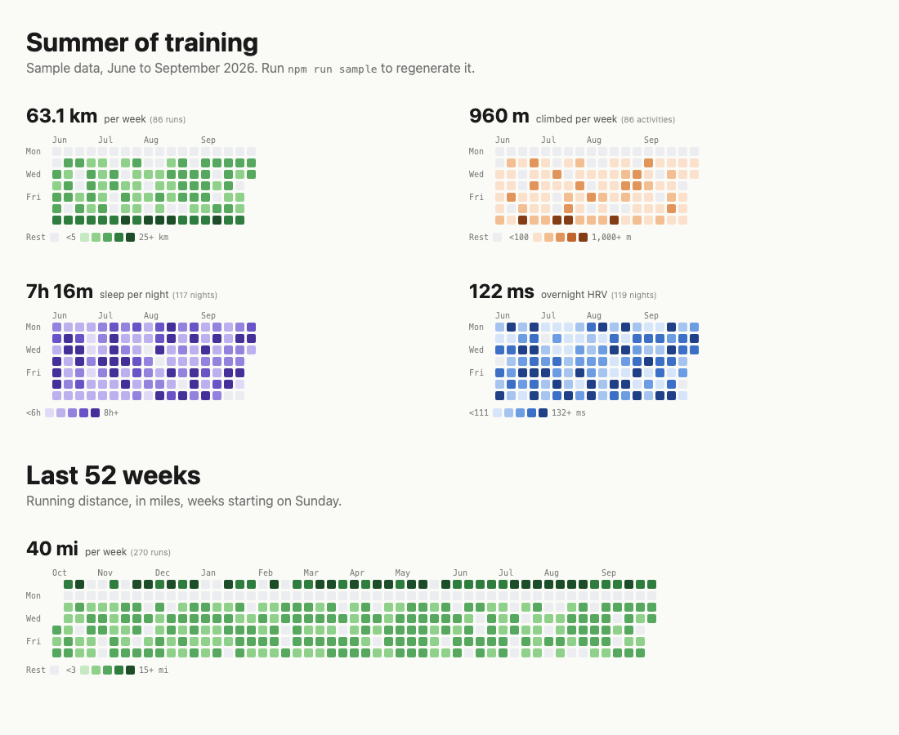

# garmin-heatmap

Garmin Connect data as GitHub-style activity grids, for static sites.



It has two parts, and no runtime dependencies:

1. **Fetching** from the
   [Garmin Connect Personal API](https://developer.garmin.com/gc-developer-program/personal/personal-api/)
   into one small record per day. Run it in CI, not in the browser: it needs your API key.
2. **Rendering** that data as SVG grids, either at build time (`garmin-heatmap build`,
   no JavaScript on the page) or in the browser (the `<garmin-heatmap>` element, reading
   a `garmin.json` written by `garmin-heatmap fetch`).

## Install

There is nothing to install: the library has no dependencies. Clone a release and run it with
Node 20 or later.

```sh
git clone --depth 1 --branch v0.1.0 https://github.com/EdSancha/garmin-heatmap
```

(`npx github:EdSancha/garmin-heatmap` doesn't work: npm 10 fails with "GitFetcher requires an
Arborist constructor to pack a tarball".)

## 1. Get your data

Create a personal API key at
[connect.garmin.com/app/settings/personalApiToken](https://connect.garmin.com/app/settings/personalApiToken).
Garmin shows it once; keys last 30 days to a year.

```sh
GARMIN_API_KEY=… node garmin-heatmap/bin/garmin-heatmap.js fetch --days 365 --out garmin.json
```

| Flag | Default | |
|---|---|---|
| `--days` | `365` | How many days back from `--end` |
| `--end` | today | Last day, `YYYY-MM-DD` |
| `--sources` | `activities,sleep,hrv,steps` | Which endpoints to call |
| `--out` | `garmin.json` | Output file |

The file is meant to be published, so it holds **daily totals only**: no
activity names, IDs, GPS coordinates or start times. Format:

```json
{
  "version": 1, "generated": "2026-10-22T05:17:00.000Z", "start": "2025-10-23", "end": "2026-10-22",
  "days": {
    "2026-06-01": {
      "activities": { "running": { "count": 1, "distance": 12034, "duration": 3710, "elevation": 85, "hard": 540 } },
      "sleep": { "seconds": 27000, "score": 82 },
      "hrv": 118,
      "steps": 11873
    }
  }
}
```

Distances and elevation are in metres, durations in seconds; `hard` is time in heart-rate zones 4 and 5. Activity keys are Garmin type keys.

## 2. Show it

### In the browser

```html
<script type="module" src="https://cdn.jsdelivr.net/gh/EdSancha/garmin-heatmap@v0.1.0/src/element.js"></script>

<garmin-heatmap src="/assets/garmin.json" metric="distance" types="running" noun="runs"></garmin-heatmap>
<garmin-heatmap src="/assets/garmin.json" metric="sleep" weeks="17"></garmin-heatmap>
```

Or copy `src/element.js`, `src/render.js`, `src/metrics.js` and `src/dates.js` into your site.
Several elements with the same `src` share one request.

### As static SVG

List the grids your site shows in a config file. Set `"enabled": false` to keep a grid
available but switched off; `build` then fetches nothing for it.

```json
{
  "grids": [
    { "name": "running", "metric": "distance", "types": ["running"], "noun": "runs" },
    { "name": "climbing", "metric": "elevation" },
    { "name": "sleep", "metric": "sleep", "weeks": 17, "enabled": false },
    { "name": "hrv", "metric": "hrv", "weeks": 17, "enabled": false }
  ]
}
```

```sh
GARMIN_API_KEY=… node garmin-heatmap/bin/garmin-heatmap.js build --config heatmaps.json --out-dir _includes/garmin [--themes light,dark]
```

`build` works out which sources and dates the enabled grids need, fetches only those, and
writes `<name>.svg` per grid (removing SVGs of grids no longer enabled). It writes nothing
until every grid has rendered. No dataset is written unless you add `--data-out garmin.json`.
Grid keys are `name`, `enabled` and the options below.

Inline the SVGs (`` in Jekyll) so they pick up your page's
font and text colour. For a single grid, `render` draws one SVG from a dataset:

```sh
node garmin-heatmap/bin/garmin-heatmap.js render --data garmin.json --metric hrv --out hrv.svg
```

### Options

Attributes on the element, keys in a `build` config, flags on `render`:

| Option | Default | |
|---|---|---|
| `metric` | `distance` | `distance`, `elevation`, `duration`, `intensity` (minutes in heart-rate zones 4–5), `activities`, `sleep`, `sleep-score`, `hrv`, `steps` |
| `types` | all | Activity types, comma-separated. `running` also matches `trail_running`, `treadmill_running`… |
| `start`, `end` | last `weeks` weeks | `YYYY-MM-DD` |
| `weeks` | `52` | Used when `start` is not set |
| `week-start` | `monday` | `monday`, `sunday` or `0`–`6` |
| `units` | `metric` | `metric` or `imperial` |
| `locale` | `en` | Month, weekday and number formats |
| `thresholds` | per metric | Four cut points between the five colour levels, or `auto` (quintiles of your data; HRV's default) |
| `palette` | per metric | Six colours: rest/no data, then the five levels |
| `theme` | none | For standalone images, which can't take page colours. `auto`: mid-grey text and translucent colours that read on any background (best for a GitHub README). `light` or `dark`: fixed colours for a known background. Without it, text follows the page (`currentColor`) |
| `summary` | `true` | `false` hides the headline number |
| `legend` | `true` | `false` hides the legend |
| `noun` | `activities` | Word in the headline count, e.g. `runs` |
| `title` | metric and dates | Accessible name |
| `cell-size`, `gap`, `radius` | `11`, `3`, `2` | Cell geometry, in px |

Labels use `currentColor`; set `--garmin-heatmap-font` to change the headline font.
Each cell has a `<title>` tooltip and `data-date` / `data-value` attributes.

### On a GitHub profile

A GitHub README can show SVG images, but not inline SVG, page CSS or scripts. Render standalone
versions with `build --themes auto` (`<name>-auto.svg` next to each `<name>.svg`), publish them
somewhere public (your site, for example) and link them:

```html

```

Use `auto` rather than a `<picture>` that switches between `light` and `dark`: `<picture>` follows
the browser's colour scheme, not the reader's GitHub theme, so a reader with a light system and
GitHub set to dark gets the light image on a dark page.

Serving the images from a site that already fetches the data keeps your API key in one place,
and the profile repository needs no workflow or daily commits.

## Keeping the data fresh

The access token lasts 24 hours and there are no refresh tokens, so fetch a new
one on every run (the CLI does). [`examples/update-garmin-data.yml`](examples/update-garmin-data.yml)
is a GitHub Actions workflow that commits a fresh `garmin.json` daily, for hosts
that build straight from the repo. If your site already deploys from its own
workflow, fetch in that workflow instead (on a daily `schedule`), so the data
never enters git history. Either way, store the key as described in
[Security](#security), and replace it before it expires (Garmin emails a week ahead).

## Security

The personal API key reads **all** your Garmin Connect data (activities, health, sleep, weight,
nutrition, women's health), not just what a heatmap shows. Treat it like a password.

**The key**
- Never commit it, and never put it in a workflow file. Keep it in a GitHub Actions secret, ideally
  an *environment* secret: create an environment (e.g. `garmin`) whose deployment branches allow
  only your default branch, then `gh secret set GARMIN_API_KEY --env garmin`. Workflows on other
  branches, and pull requests from forks, can't read it.
- Pass it only to the step that runs `fetch`, never at job or workflow level. In a job that also
  runs other code (Jekyll plugins, builds of other branches), fetch in a separate job and hand the
  output over as an artifact.
- Choose the shortest lifetime you'll comfortably renew (90 or 180 days). If it may have leaked,
  delete it in Connect settings; that revokes it at once.
- Locally, read it from a password manager rather than typing it into your shell history:
  `GARMIN_API_KEY=$(op read "op://Private/Garmin Personal API/credential") node garmin-heatmap/bin/garmin-heatmap.js fetch`.

**The code that sees the key**
- `fetch` sends the key only to `personal.connectapi.garmin.com`, never logs it or the token, and
  masks the token in GitHub Actions logs (logs of public repositories are public).
- In workflows, check out a commit SHA you have reviewed rather than a tag, which can move (see
  [`examples/update-garmin-data.yml`](examples/update-garmin-data.yml)). With no dependencies,
  that commit is all the code that sees your key; no npm install runs.

**What gets published**
- The dataset is public once deployed: daily totals, no names, IDs, locations or times. Daily
  totals still show your routine, sleep and recovery, so fetch only the sources you display
  (`--sources activities`).
- `build` fetches only the sources its enabled grids need and publishes only the grids, not the
  dataset. Sleep and HRV stay unfetched until you enable a grid that shows them.
- Committing the dataset keeps every daily version in git history. Fetching at build time doesn't.

## Development

```sh
npm test             # node:test, no dependencies
npm run sample       # regenerate examples/sample.json (made-up data)
npm run serve        # then open http://localhost:8000/examples/
```

## Licence

MIT
